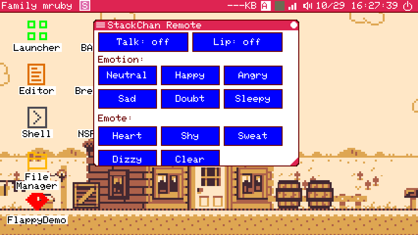
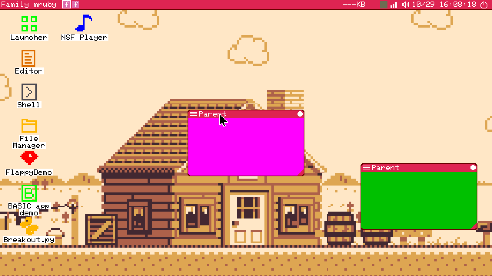
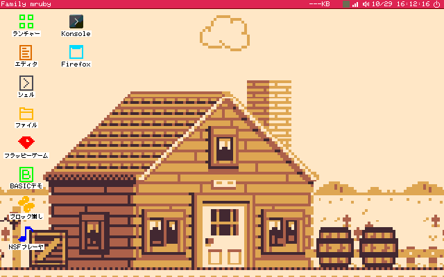

# L15 報告: VM の確認で見つけたものの直し

> 状態: 完了 (A・C・E・F は指示どおり。B は VM の崩れを手元で再現できず、切り抜きの補強と確認の追加まで。D は印が出るが、角に自分の絵を描くアプリでは隠れる。どちらも仕様の判断を残件に書いた) | 更新: 2026-10-29 | 指示書は instruction_l15.md。ブランチは fmruby-core の feature/linux-native (未 push)

## コミット

| コミット | 中身 |
|---|---|
| 5413e329 | A: 機種の定義の `compositor.mime_desktops`、mimeapps.list を探す順 |
| 51e2881e | E: Flappy の鳥の輪郭 |
| 92267865 | C: セッションの台本の残る記録 |
| b0201d1c | D: リサイズの印 (コードと試験の道具) |
| 9ae28058 | D: 描画の記録の基準の更新 (**基準だけのコミット**) |
| b2f2696b | B: 切り抜きの当て直し、合わせて大きくなった代役を画面に戻す、wl_size_check |
| 17068ba5 | F: デスクトップの Linux のアプリのショートカット |
| 478e2159 | C の続き: wl_settings_check を新しい行と残る記録に合わせた |

この報告は別のコミット。

## A. 既定のアプリ

- 欄: 機種の定義 `[compositor] mime_desktops` (文字列の並び)。`linux_pc_wl.toml` の既定は `["kde"]`、組み込みの既定 (sdl.toml 相当) は空。GNOME の機械なら `["gnome"]` にすれば `gnome-mimeapps.list` を読む。名前に使えるのは英数字・`-`・`_` だけ (ファイル名になるため。`../x` は断る)。
- 振る舞い: `XDG_CURRENT_DESKTOP=family-mruby` は変えていない。mimeapps.list を探す順は各ディレクトリで `family-mruby-mimeapps.list` → `kde-mimeapps.list` → `mimeapps.list` (XDG の仕様で `XDG_CURRENT_DESKTOP=family-mruby:KDE` としたときと同じ並び)。`linux_mime_lists_load` は名前をコロン区切りで受けるようにし、`linux_apps` の設定に `mime_desktops` を足した (OnlyShowIn に使う自分の名前とは別)。
- 入っていないアプリを飛ばすのは前からの作り (`[Default Applications]` の並びの先頭から、入っている最初のもの。無ければ次の種類・次の一覧・`MimeType` の候補へ)。xdg-mime (GLib) と同じ。
- 確認: `test/native/apps.c` に VM の組み合わせを再現する試験を足した。`kde-mimeapps.list` に `image/png=org.kde.gwenview.desktop`・`application/pdf=okularApplication_pdf.desktop` (Okular の .desktop は無い)、`mimeapps.list` に `image/png=browser.desktop`、別のディレクトリに `gnome-mimeapps.list`。PNG は Gwenview (既定で開くと Gwenview にパスが渡る)、PDF は Okular を飛ばして次の候補 (MimeType を持つブラウザ)、`family-mruby` だけでは `kde-mimeapps.list` を読まない (VM の症状)、`family-mruby:gnome` で GNOME の一覧を読む。native apps 103 → 111 checks。機種の定義の試験に 4 つ (544 checks)。

## B. Firefox の窓が崩れる

### 調べたこと

- 大きさに従わない窓を作る試しのクライアントを足した: `wl_dialog` に `sub W H` (窓より大きい subsurface。ブラウザがページを subsurface に描く形)、`own W H [noack]` (頼まれた大きさを無視して自分の大きさで描く。configure に答えるかどうか)、`remap` (隠して出し直す)。`x11_dialog` に `own W H` (X11 で自分の大きさを頼む)。`wl_dialog` は窓の geometry を自分で言うようにした (ツールキットと同じ)。
- 2 つの窓を並べ、A を前に、B を右に置いて、A を画面より大きく描かせ、A の色 (マゼンタ) が A の代役の中身の外 (B の穴を含む) に出る画素を数えた。**直す前のビルドでも 5 つの場面すべてで 0 画素** (pixman、標準・全部 mruby)。VM の崩れは再現できなかった。
- 見立て (撤回はしていないが確かめられなかったもの): Firefox が geometry の位置 (影の分) だけを変える commit をした、または切り抜きの後に作った subsurface を wlroots が切らない場合。前者は以前のコードでは大きさが変わったときにしか当て直していなかった。後者は手元の wlroots 0.19 では切られた (場面 0)。
- 題の帯が古い幅のままだったこと: Wayland の窓は、頼んだ configure そのものに答えた commit のときだけ代役が窓に合わせる (L9a の FIT)。その後に別の configure (前に出た「activated」など) があると、窓が自分の大きさで描いても合わせない。手元でも再現した (`own` の後に代役は 150x75 のまま)。Firefox もこれで代役が大きくならず、帯は代役の幅のままだったと見ている。

### 直したもの

- 切り抜き (`wlr_scene_subsurface_tree_set_clip`) を、大きさが変わったときだけでなく毎回の commit で箱が変わっていれば当て直す (同じなら何もしない)。geometry の位置の変化に追従する。X11 の窓は unmap で中身の木を作り直すので、次の中身にも当て直す。
- 合わせて大きくなった代役 (X11 の窓が自分の大きさを頼んだとき、Wayland の窓が頼んだ configure そのものに自分の大きさで答えたとき) は、画面の外にはみ出たら最小だけ戻す。前は右と下にはみ出て閉じるボタンが画面の外に出ていた (手元で再現: 550x335 の代役が x=265 から)。
- どちらに合わせるか: 「Linux の窓の大きさは Family mruby が決める」のまま、**大きさに従わない Wayland の窓は代役の大きさで切る**ことにした。代役と題の帯はいつも一致する (帯は代役の幅)。下の残件の (b) をとると代役が窓に合わせて広がるが、それは止まる条件の「代役を Linux の窓に合わせて勝手に広げる」に当たるので入れていない。
- 確認: `test/native/wl/wl_size_check.rb` (regress:wl に追加)。0. 窓より大きい subsurface、1. configure に答えずに自分の大きさ、2. 後の configure に答えて自分の大きさ、3. 自分の大きさで出し直し、4. X11 の窓が画面より大きな大きさを頼む。0〜3 は代役の大きさが変わらず (3 は新しい窓として作り直され、その大きさの代役になる)、A の中身の外のマゼンタが 0 画素、題の帯が代役の右端まである。4 は代役が 550x335 に合わせ、画面の中 (89,24) に戻り、帯が描き直され、外のマゼンタ 0。標準・全部 mruby とも 5/5。

## C. 起こし直しの記録

- 置き場所: `${XDG_STATE_HOME:-~/.local/state}/family-mruby/session.log`。書けなければ今までどおり (表示マネージャのログだけ)。
- 書くもの: セッションの始まり (`==== 日時 session PID starts`)、台本の自分の行すべて (日時付き。起動は `(run N)`、終わり方は `ended by SIGSEGV after 52s (run 1)` のように何回目の起動が何秒で終わったか、起こし直し、諦め、Exit、SIGTERM)、各回の後に Family mruby の出力の最後の 40 行 (`---- the last lines of Family mruby (run N, pid P)`)。
- 出力の取り方: プログラムの出力を FIFO から `tee` に通し、表示マネージャのログへはそのまま、`run.out` へも書く (FIFO なので `$!` はプログラムの pid のまま、シグナルの扱いも同じ)。回が終わったら tee の終わりを 1 秒まで待ち、`run.out` の末尾を session.log へ写す。Linux のプログラムが出力を開いたままでも 1 秒で tee を止めるので、セッションは止まらない。
- 大きさ: 起動時に 256 KB を超えていれば `session.log.1` へ移す (前の 1 つだけ残る)。
- 失敗の原因は直していない。
- 確認: `session_test.rb` 19 → 22 checks (時刻付きの行、回ごとの出力の末尾、256 KB を超えたら .1 へ)。`wl_settings_check.rb` の 6. に「残る記録」を足した (コンテナの中で SIGSEGV → 起こし直し → Exit の後、session.log に時刻付きの行と 2 回分の出力の末尾。標準・全部 mruby とも 20/20)。.deb の deb_check もこの台本で通る。

## D. リサイズの印

- 印: 右下の角、枠の内側に、直角の頂点を (w-2, h-2) に置いた直角三角形 (辺 8 画素)、色は題の帯の色 (`THEME_MENU_BG`。0x01 は使わない)。枠の線より先に描くので角丸の線はそのまま。
- どの窓に出すか: カーネルが右下の角で大きさを変える窓 (アプリの `ctx->resizable`。カーネルの窓の一覧の `resizable` と同じ値) で、全画面でないとき。端末やアプリで判定は食い違わなかった。
- 共通の所: mruby の基底 (`lib/add/picoruby-fmrb-app/mrblib/fmrb-app.rb` の `draw_window_frame`、`_init` が `@_resizable` を置く) と Spinel の基底 (`fmrb_app_base_spinel.rb` の `_paint_frame`。init の記録を 50 → 52 バイトにして 50 バイト目に resizable。記録は PSRAM) の両方に `draw_resize_mark(w, h)` を足した。Linux の窓の代役は自分の四角をやめてこれを呼ぶ。
- 代役の角: 印が角の半分になり、残り半分は Linux の窓が見える穴になったので、コンポジタは代役の右下 10x10 (中身の最後の 9 列・9 行) をポインタについては Family mruby のものとして扱う (`comp_route_at`)。どの窓でもその角は大きさの変更なので振る舞いは前と同じ。comp の試験 144 → 147。
- 描画の記録の基準 (別コミット 9ae28058): 24 場面 (stackchan_remote の 4、logviewer の 8、appstore の 12) が、枠を描くたびに `fill_triangle` 1 行増えただけ。ほかの行は変わらない。記録の道具が `.app.toml` の `resizable` (と LogViewer・App Store は場面の窓に `resizable: true`、スポーナーと同じ) を読むようにした。
- `regress:screens` (retro・modern・native) の基準は変わらなかった (23/23)。場面に右下の角が見える大きさを変えられる窓が無い: エディタの窓はステータス行が角を塗る。
- 内蔵 RAM: `rake regress:size` で NARYAv3・TAB5 とも DIRAM・IRAM・other **+0**。
- 画面: `l15_window_mark.png` (ネイティブ版の SDL の形、StackChan Remote の窓、2 倍)、`l15_standin_mark.png` (コンポジタ、2 つの代役。右の緑の窓の右下に印、wl_size_check の場面 2)。

- 見立てと違った点: 印は枠と同じ時に描くので、**枠の後で右下の角に自分の絵を描くアプリでは隠れる**。エディタ (ステータス行) と LogViewer (スクロールバーの下ボタンが右下の 10x10 にちょうど重なる) がそう。LogViewer の下ボタンは前から押せない (カーネルがその角を大きさの変更に取る)。残件に書いた。
- MicroPython のアプリ (`.py`、resizable = 1 のとき) には出していない。印の判定を Python に渡すには `components/micropython/modules/` の変更と `rake micropython:gen` が要り、触ってよい範囲の外。

## E. Flappy の鳥

- `bird_body.bmp`・`bird_up.bmp`・`bird_down.bmp` の輪郭の 0x01 (42・53・51 画素) を 0x20 (36,0,0) に置き換えた。0x00 はスプライトの透明色、0x01 は窓の色キーなので、残る中で一番暗い色 (0x01 の 0,0,85 と明るさが近い)。パレットは RGB332 そのままなので、パレットの索引と色は一致している。`pipe`・`grass`・`pipe_cap` に 0x01 は無い。
- ほかの BMP で 0x01 を持つもの (直していない): `flash/usr/share/basic/tile_a.bmp` (2,890 画素)。`flash/cache/` (git の外、Flappy が写した古い写し) にも鳥の 2 枚があるが、Flappy は起動のたびに写し直す。

## F. Linux のアプリのショートカット

- 置き場所: `desktop.toml` (`/usr/share/desktop/` の既定、利用者の `/home/desktop.toml` も同じ書き方)。`apps` の並びに `"linux:<desktop file id>"` を書く。`"linux:a|b"` は入っている最初のもの。既定に足したもの: `linux:org.kde.konsole`、`linux:firefox|firefox_firefox|org.mozilla.firefox` (.deb・snap・flatpak)、`linux:google-chrome|com.google.Chrome`。
- 振る舞い: Linux の区分の一覧 (`FmrbApp.linux_apps`) から名前と Breeze のアイコン (区分と同じ BMP) を取り、ダブルクリックで `FmrbApp.linux_launch(id)` (区分から起動するのと同じ口)。入っていないものは出さない。Linux 版以外では一覧が "" なので黙って出さない (「無いアプリ」に数えないので、Reload の後の壁紙の描き直しも増えない)。一覧は別のスレッドで読むので、起動時に読み終わっていなければ on_update が読み終わりを待って解き直し、壁紙を描き直す。
- 利用者がすでに `/home/desktop.toml` を持っていれば、そこに書くまで出ない (今までの決まりどおり)。
- 確認: `wl_apps_check.rb` に 1c を足した。Konsole と snap の Firefox の代役 (Exec=true)、Chrome は無し: 11 個のうち 10 個、2 列目の上の 2 つに名前の板、3 つ目は無し、ダブルクリックで `linux apps: started "Konsole"`。標準・全部 mruby とも 10/10。

## 確認の結果

- `rake regress`: host 19/19、描画の記録 205/205 (基準の更新の後)。
- `rake native:test`: 544 + 97 + 52 + 17 + session 22 + settings 53 + apps 111 + comp 147 + clip 26。
- `rake regress:size`: NARYAv3・TAB5 とも内蔵 RAM +0。flash は基準 (6f7b5848) から NARYAv3 +70,960 / TAB5 +77,040 (L14 までの分を含む)。
- `ONLY=retro,modern,native rake regress:screens`: 23/23 (retro 8・modern 10・native 2・native-keys 3、エディタの 1 打鍵を含む)。基準は変わらず。
- `rake regress:wl`: 標準・全部 mruby とも wl_check 26/26、wl_apps_check 10/10、wl_dialog_check 11/11、wl_keys_check 3/3、wl_open_check 5/5、wl_clip_check 5/5、wl_ime_check 7/7、wl_winops_check 11/11、wl_settings_check 20/20 (標準は台本の行を直した後に流し直した)、wl_size_check 5/5。
- .deb: `native/build-deb/family-mruby_2.1.0+git992.478e2159_amd64.deb` (3.4 MB)。deb_check amd64 19/19、native:scan 通る。
- ブラウザ版の画面 (`regress:screens` の web) は流していない (tools/fmrb_web.rb のブラウザを閉じないため)。

## 残件 (判断が要るもの)

1. B: Wayland の窓が頼んだ configure の後に別の configure (activated など) に答えてから自分の大きさで描くと、代役が合わせない (今の FIT は頼んだ configure の serial と同じときだけ)。候補:
   - (a) 今のまま: 代役は Family mruby の大きさ、窓は切られる (Firefox はページの右と下が見えない)。
   - (b) 頼んだ configure 以降のどれかに答えていれば合わせる (`configure_serial - asked_serial >= 0`): 代役が窓の大きさ (画面まで) に広がり、画面の中に戻る。試した結果: wl_size_check の場面 1・2 で代役が 150x75 → 550x335 になり、帯も描き直された。止まる条件に当たるので入れていない。
2. B: VM の崩れそのものは再現していない。次の VM の確認で同じ手順 (File Manager から PDF を Firefox で) を流し、崩れたら `comp info` (窓の大きさと置き場所) と Firefox が Wayland か X11 か (`xprop` が効くか) を取ってほしい。
3. D: 印が角に絵を描くアプリで隠れる (エディタ、LogViewer)。候補: (a) 今のまま (アプリが角を描かなければ見える)、(b) present のたびに印を上に描き直す (大きさを変えられる窓だけ、1 命令ずつ。Retro は SPI の送りが増える)、(c) 各アプリが角を空ける。LogViewer の下ボタンは角と重なって前から押せない。
4. D: MicroPython のアプリに印を出す (範囲外の `components/micropython/` と再生成が要る)。
5. E: `flash/usr/share/basic/tile_a.bmp` の 0x01 (BASIC の絵として透けるのが意図かは未確認)。
6. C: 起こし直しの直後の失敗の原因は、次に起きたとき `~/.local/state/family-mruby/session.log` を読んでから。
