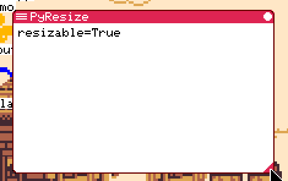

# L15b 報告: L15 の残件 (右下の角・MicroPython の印・デスクトップのアイコンの一覧)

> 状態: 完了 (1〜3 とも指示どおり。止まる条件には当たらなかった) | 更新: 2026-10-29 | 指示書は instruction_l15b.md。ブランチは fmruby-core の feature/linux-native (未 push)

## コミット

| コミット | 中身 |
|---|---|
| bcf2ebb8 | 1: 基底の `resize_corner`、エディタ・LogViewer・App Store が角を空ける |
| 8943ba65 | 2: MicroPython の枠の印 (と `rake micropython:gen` の再生成物) |
| 93df9ea3 | 3: `/home/desktop.toml` の apps + hidden、ホストの試験 |
| c0cd675f | 描画の記録と画面の基準の更新 (**基準だけのコミット**) |

この報告と画面は別のコミット。

## 1. 右下の角を空ける

- 共通の所: mruby の基底 (`fmrb-app.rb`) と Spinel の基底 (`fmrb_app_base_spinel.rb`) に `resize_corner` を足した。大きさを変えられる窓で全画面でないとき 9、それ以外は 0。ivar は足していない (メソッドだけ)。
- 9 にした理由 (指示の「印の分 (8)」から 1 増やした): カーネルが大きさの変更に取る角は窓の最後の 10x10 (input_router)、枠の内側では 9x9。8 で空けると LogViewer の下ボタンの最後の 1 行がまだ掴みの中に残り、エディタのかなの印の右端 1 列も掴みに入る。9 なら印 (8x8) と掴みの両方から外れる。印と隣の絵の間に 1 画素の隙間ができるだけで、見た目はほぼ同じ。
- エディタ (`editor/render.rb`): ステータス行とその右端の印 (`[A]`、問題の数) が `resize_corner` だけ手前で止まる。`redraw_all` は枠を描く直前に角 (幅 9、ステータス行の高さ) を紙の色で塗り、その上に枠が印を描く。1 打鍵の描き直し (`redraw_dirty`) は角に触れないので印が残る。かなの印のクリック判定は描いた位置から取るのでそのまま。
- LogViewer (`logviewer.app.rb`): スクロールバーの高さを `resize_corner` だけ短くした (作る所を `build_scrollbar` 1 つにまとめた)。下ボタンは角の上に来て押せる。ネイティブ版で確認: ホイールで上へ戻してから下ボタンを押すと半頁進み、窓の大きさは変わらなかった。
- App Store (`appstore.app.rb`): 見て回った中で角に描くもう 1 つ。選んだアプリの説明の欄 (下の 40 行) を、選択が変わるたびに窓の幅いっぱいに塗っていた。Modern は右下に絵の欄があって角は前から空いている。Retro (絵なし) だけ、欄の最後の 9 行を 9 画素狭く塗り、注記の 2 行目の文字数をその幅に合わせた (1〜2 文字減る)。
- 見た窓の残り (大きさを変えられるもの: カーネルの spawner の表と `.app.toml` の `resizable`):
  - Shell: 直していない。履歴のスクロールバーは入力行の上で終わり、入力行の文字はバーの列の手前で止まるので印は隠れない。ただし計算では、入力が 1 行で `(user_area_height - 2)` が文字の高さで割り切れる大きさのとき、下ボタンの最後の 1 行だけが掴みの行 (窓の下から 10 行目) に入る。押せないのはその 1 行だけ。
  - StackChan・StackChan Remote: 中身の後に枠を描くので印は見える (L15 で確認済み)。
  - Linux の窓の代役: 自分で枠と印を描く (L15)。
  - keys のデスクトップのアプリはいつも全画面なので関係しない。
- 使い勝手の変化: 表示できる行数は変わらない。エディタのステータス行は 9 画素 (約 1.5 文字) 短くなり、長いメッセージがその分早く切れる。LogViewer のスクロールバーは 9 画素短い (つまみの動く幅が減るだけ)。止まる条件には当たらないと判断した。
- 全画面: `resize_corner` が 0 なので今までどおり (エディタの全画面・高解像度の全画面も同じ)。

## 2. MicroPython のアプリの印

- `components/micropython/` の Family mruby 側だけを直した (submodule の本体は触っていない)。
  - `modules/fmrb_mp_bridge.h`・`fmrb_bridge.c`: 起動時の情報に `resizable` (アプリの `ctx->resizable`)。
  - `modules/fmrb_module.c`: `_fmrb.init()` の辞書に `resizable`。
  - `prelude/fmrb_app.py`: `self.resizable`、`RESIZE_MARK = 8`、`draw_resize_mark(w, h)` (Ruby と同じ三角、題の帯の色)、`resize_corner()`。`draw_window_frame` が枠の線の前に印を描く。
- 再生成: `rake micropython:gen` (`:prelude` で `prelude/fmrb_prelude.h` を作り直し、`make -C components/micropython/port` で `mp_embed/` を作り直す。make と python3 が要る)。差分は `qstrdefs.generated.h` に `MP_QSTR_resizable` が 1 行と、`mpversion.h` の日付だけ。両方をコミットした。
- `rake micropython:smoke`: 通る (rake test の中でも流れる)。smoke は prelude を通らないので、印そのものはネイティブ版で見た。
- ネイティブ版で `resizable = 1` の試しの .py アプリ (コミットしていない) を起こすと、右下に印が出る。角を掴んで 160x90 → 214x134 に広げても、`on_resize` の後の枠に印が出る。
- 文書: `doc/micropython/known_limitations.md` の FmrbApp の表に `resizable`・`draw_resize_mark`・`resize_corner` を足した。

## 3. デスクトップのアイコンの一覧

- 形: `/home/desktop.toml` に `apps = [...]` (表示する、上から順) と `hidden = [...]` (外したもの)。書くのは今までどおりアイコンのメニュー (ランチャーの右クリック、D) だけで、両方を書く。
- 起動時 (`load_desktop_icon_paths`):
  - ファイルが無い: 既定 (`/usr/share/desktop/desktop.toml`) を使い、書かない。
  - 読めない・壊れている: 今までどおり無いものとして既定を使い、ファイルには触らない。
  - `hidden` が無い (前の形): 既定で置き換えて書き戻す (`hidden = []`)。既定が読めないときだけは前の形の `apps` をそのまま使う (空の一覧で上書きしないため)。
  - 新しい形: 既定にあって `apps` にも `hidden` にも無いものを `apps` の末尾に足し、足したときだけ書き戻す。
- メニュー: 外すと `apps` から除いて `hidden` へ、足すと `hidden` から除いて `apps` の末尾へ。
- `linux:` の項目は今までどおり、入っていなければ `apps` にあっても出さない。
- keys のデスクトップ: アイコンも desktop.toml も使っていない (メニューの一覧は `.app.toml` の宣言から作る)。直すものは無かった。
- アイコンのメニューから `linux:` の項目は**足せない**。ランチャーの「Linux」の区分ではメニューが Reload だけで、D キーの経路も `linux_entry?` のときは何もしない (L9b の作り)。足せるようにするのはこの段の範囲外なので残件に書いた。既定に入っているもの (Konsole・Firefox・Chrome) はメニューで外せる。外すと `hidden` に入って戻らない。
- 試験: `test/desktop_icons/run.rb` (`rake desktop_icons:test`、`rake test` に入れたので `rake regress` の host が 19 → 20)。本物の mixin を CRuby で読み、2 つのパスを作業用のディレクトリに向ける。30 checks: ファイルが無いと既定を使って作らない、メニューで外す・足す・足し直す・外し直すときの 2 つの一覧とファイル、既定に足した 2 つが末尾に入って書き戻され、次の起動では書き直さない、`hidden` の項目は既定の順が変わっても戻らない、`hidden` の無い形は既定で上書き、`hidden = []` は新しい形、`hidden` が先・複数行・注記つき、壊れたファイルは触らない、既定が無いときの扱い。
- ネイティブ版 (利用者の場所は作業用のディレクトリ) でも見た: 前の形 (`apps` だけ) が起動で既定の 11 項目と `hidden = []` に書き換わる。ランチャーで Shell を選んで D を押すと `hidden` に入り、もう一度 D で `apps` の末尾に戻る。外したまま起こし直すと Shell は出ず (7/10)、ファイルは書き直されない。
- 既定の desktop.toml の頭の説明を新しい振る舞いに合わせた。

## 確認の結果

- `rake regress`: host 20/20、描画の記録 205/205 (基準の更新の後)。
- 描画の記録の基準 (c0cd675f、11 場面): LogViewer の 8 場面はスクロールバーが 9 画素短くなり、下ボタンとつまみが上へ。App Store の Retro の 3 場面は説明の欄の塗りが 2 つに分かれ、下の 9 行が 9 画素狭い。ほかの行は変わらない。
- `ONLY=retro,modern,native rake regress:screens`: 24 通り、3 落ち (retro・modern・native の `editor_type`。117 px、ステータス行の右端 (216,206)-(243,213))。写しを見て、`[A]` が 9 画素左へ寄り角に印が出ていることを確かめてから基準にした (c0cd675f)。ほかの場面は基準どおり (retro 8・modern 10・native 2・native-keys 4)。
- `rake regress:size`: NARYAv3・TAB5 とも DIRAM・IRAM・other **+0**。flash は基準 (6f7b5848) から NARYAv3 +76,544 / TAB5 +83,008 (S1 の時点が +72,928 / +79,024 なので、この段で約 3.6〜4 KB。MicroPython の prelude の Python の文と、デスクトップの読み込み)。
- `rake regress:wl`: 標準・全部 mruby とも wl_check 26/26、wl_apps_check 10/10、wl_dialog_check 11/11、wl_keys_check 3/3、wl_open_check 5/5、wl_clip_check 5/5、wl_ime_check 7/7、wl_winops_check 11/11、wl_settings_check 20/20、wl_size_check 5/5。
  - 1 回目は標準の wl_check の「keys to Family mruby」(エディタの窓を `editor_type` の基準と比べる) が 116 px で落ちた。`native:wl` は Spinel の生成物 (`main/prebuild_scripts/spinel/gen/`) を作り直さず、そこが変更の前の古いエディタのままだった (regress:screens・regress:size は終わると生成物を始める前の状態に戻す)。`rake spinel:gen` の後に流し直して全部通った。同じ 1 回目で全部 mruby の「fullscreen shooter」も 1 回落ちた (絵の一致が 98.0%、しきい値ちょうど。動くゲームの撮る時の揺れ) が、流し直しでは通り、この段の変更とは関係しない。
- `rake micropython:smoke`: 通る。
- .deb: `native/build-deb/family-mruby_2.1.0+git1008.c0cd675f_amd64.deb` (3.4 MB)。native:scan 通る (追跡外のファイル・認証情報なし)、deb_check amd64 19/19。
- ブラウザ版は流していない (tools/fmrb_web.rb のブラウザを閉じないため)。Spinel の基底を変えたので、ブラウザ版で見るときは `spinel:gen` からの作り直しが要る。

## 残件

1. アイコンのメニューから `linux:` の項目を足す口が無い (ランチャーの Linux の区分のメニューは Reload だけ)。今は既定の desktop.toml か手書きでだけ入る。
2. Shell の履歴のスクロールバーの下ボタンは、大きさによって最後の 1 行だけが掴みの行に入る (上の 1. の一覧)。直すなら LogViewer と同じく `resize_corner` で短くする。
3. `doc/desktop_icons/` の文書 (plan と ds1・ds2) は `apps` だけの形のまま。そちらの企画を閉じるときに合わせる。
