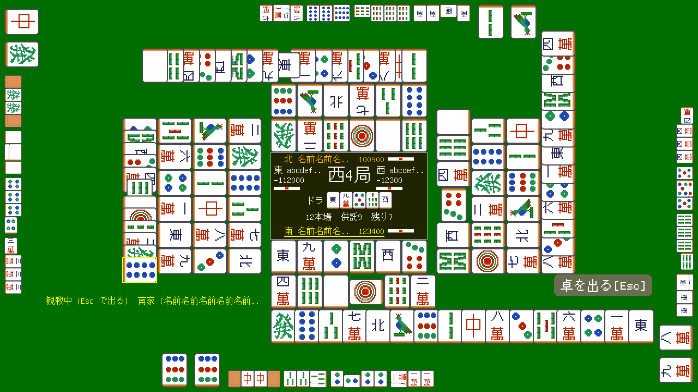
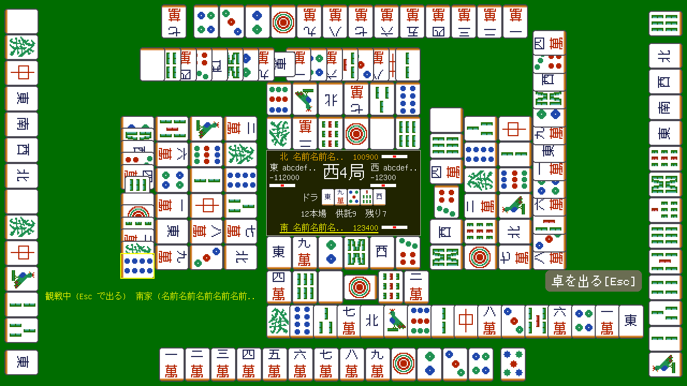
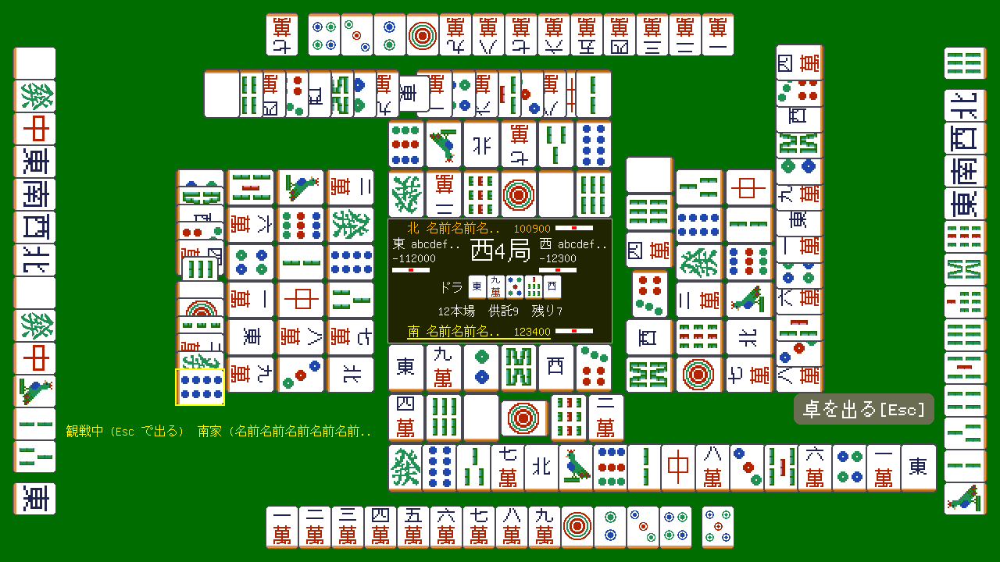
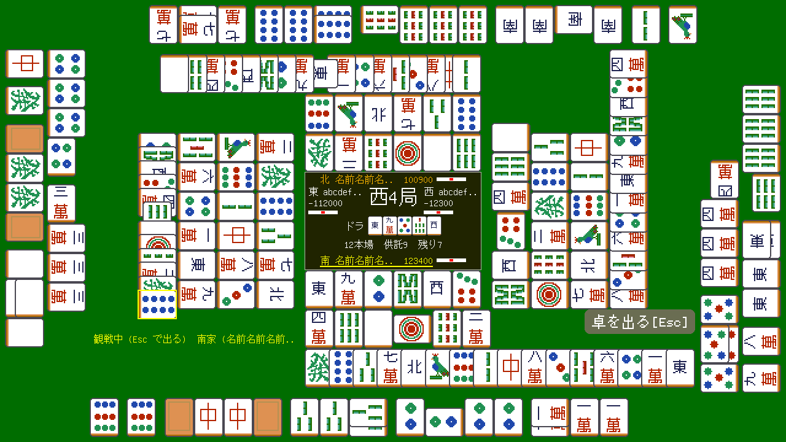

# MJ10 報告: 1280x720 の観戦・振り返りで 4 人の手牌を大きく (案)

> 状態: 完了 | 更新: 2026-10-18 | instruction_mj10.md の結果。観戦の画面 (牌譜の振り返りも同じ画面) の手牌を今の 24x32 より大きくする配置を 3 案作り、ブラウザ版 1280x720 で最悪の形と普通の形を写した。3 案ともはみ出し検査は失敗 0。**ユーザが案 1 (河の牌 48x64 で 1 行) を選び (2026-10-18)、feature/mj10-river48 を develop にマージした**。案 2・3 のブランチは消した

## 1. 前提と共通の変更

- 対象は観戦の画面で、手牌が見えるとき (ホストが `sh` を出すとき) だけ。自分が座っている卓、手牌を出さないホストの観戦 (背中と下の大きい手牌)、640x360 は変えていない。
- 3 案とも、観戦の画面だけ盤と河を **44 ドット下げる** (盤の上端 236 → 280)。上の席の手牌を河の上に置く場所を作るため。盤・河の大きさと並びは今のまま。
- 数字の違う部分を表にまとめた (`XL_SEAT` = 座っている卓の今の数字、`XL_SPEC` = 観戦の数字: 盤の上端、各河の最後の行の長さ、行の始まり、状況の行、ボタンの段と右端、はみ出し検査の枠)。`xl_draw` が画面ごとにどちらかを選ぶ。画面の種類 (`"spec"` / `"table"`) が変われば全部描き直す。
- 観戦の手牌の行は新しい `xl_spec_items` (手牌 → 自摸の牌 → 鳴き、最初の鳴きがいちばん奥) で作る。行が枠より長くなる (ありえない形、検査の牌譜の場面がこれ) と、河の最後の行と同じく詰める (`close_up`)。
- 鳴きの声 (`SHOUT_XL`) と局の名前の表示は、下げた盤に合わせて一緒に下げた。
- はみ出し検査に観戦の最悪の場面を 3 つ足した (`fixtures.rb`): `spectator_worst` (4 人とも槓 4 つ、4 人とも自摸の牌、河 28-31 枚)、`spectator_long` (4 人とも門前 13 枚と自摸の牌 = 行がいちばん長い、河 28-31 枚)、`spectator_one_kan` (4 人とも槓 1 つと手牌 10 枚と自摸の牌)。自摸の牌が 4 人同時にあるのは実際には無いが、各行の最悪を一度に見るため。
- 行の長さの最大 (ドット、行に沿って): 手牌は鳴きの分だけ減るので、鳴き無し 13 枚 + 自摸の牌がいちばん長い。小さい牌の鳴きなら槓 4 つでもそれより短い。

## 2. 案

### 案 1 (推奨): 河の牌 (48x64) で 1 行 — `feature/mj10-river48`

- 手牌を河と同じ 48x64 (`tiles_river2_r0/r90/r180/r270`、新しいシートは無い) で、席ごとに 1 行。鳴きは今と同じ小さい牌 (24x32) で行の奥。
- 行: 上 x 296-984 / y 8-72、下 x 296-984 / y 648-712、左 x 8-72 / y 16-704、右 x 1208-1272 / y 16-704 (左右は画面の高さいっぱい)。行の最大は 13 × 48 + 12 (自摸の前の隙間) + 48 = 684 で、枠は 688。
- ほか: 状況の行 [80, 540, 400, 56]、ボタンの段 y 592/548/504/460・右端 1196、下の河の最後の行 704 まで。
- 利点: いちばん大きい牌で、4 人とも 1 行で読める。河と同じ牌なので見た目がそろう。新しいシートが要らない (配布物が増えない)。変更は観戦の画面の数字と行の作りだけ。
- 欠点: 余白が少ない (左右の行は 720 のうち 688、上の行と右の河の最後の行の間は 8 ドット)。鳴きは小さいまま (手牌との大きさの差が目立つ)。下の行が画面の下端から 8 ドット。

### 案 2: 手牌のシートの牌 (42x56) で 1 行 — `feature/mj10-hand42`

- 手牌を `tiles_hand.bmp` そのもの (42x56、1 倍、手書きの絵がそのまま) を 4 向きに回した牌で、席ごとに 1 行。鳴きは小さい牌のまま。
- 回したシート 3 枚を `mahjong_tilegen.rb --layout-sheets` に足した (`large/tiles_hand_r90.bmp` 560x168、`tiles_hand_r180.bmp` 420x224、`tiles_hand_r270.bmp` 560x168、各 95 KB。上向きは `tiles_hand.bmp` を使う)。観戦の行を初めて描くときに読む。
- 行: 上 x 340-940 / y 16-72、下 x 340-940 / y 648-704、左 x 16-72 / y 60-660、右 x 1208-1264 / y 60-660。行の最大 13 × 42 + 12 + 42 = 600。ほかの数字は案 1 と同じ。
- 利点: 手牌用に描いた絵 (筒子の二重丸、索子の細部) がそのまま出る。余白に余裕がある (左右 600/720、画面の端から 16 ドット)。1 行で読める。
- 欠点: 案 1 より一回り小さい (面積で 0.77 倍)。河 (48x64) より小さい手牌になり大きさがそろわない。シートが 3 枚 (約 280 KB) 増え、ブラウザ版の束が大きくなる。基板 (Tab5・P4-Nano) の束から外す一覧 (`config/storage_exclude_*.txt`) にも足す必要がある (範囲外なので触っていない)。鳴きは小さいまま。

### 案 3: 鳴きも河の牌、左右は 2 行に折る — `feature/mj10-fold`

- 手牌も鳴きも 48x64。加槓の 4 枚目は横の牌に 16 ドット卓寄りで重ねる (行の奥行き 64 に収まる)。
- 上と下は 1 行 (最大: 槓 4 つ = 2 × 48 + 12 + 14 + 4 × 208 + 3 × 12 = 990)。行: 上 x 146-1136 / y 8-72、下 x 146-1136 / y 648-712。
- 左右は 2 行に折る (1 行 560、外側が先、2 行目は卓寄り。行の真ん中を越えて始まる単位か、入りきらない単位から 2 行目。鳴きは割らない)。左 x 8-140 / y 80-640、右 x 1140-1272 / y 80-640。
- そのために右の河の最後の行を 448 → 424、下の河の最後の行を 636 まで、ボタンの右端を 1132、状況の行を [148, 540, 332, 56] に詰めた。
- 利点: 鳴きまで含めて全部が河と同じ大きさで、いちばん見やすい牌の量が多い。新しいシートが要らない。
- 欠点: 左右の手牌が途中で折れて、1 行で並べて読めない (理牌の順がどこで切れるかは手による)。画面がいちばん混む (上下の行がほぼ横幅いっぱい、河の最後の行がより詰まる)。行を作る処理が少し複雑。

## 3. 画面

ブラウザ版 1280x720 (`rake wasm:web` を各ブランチで作り直し、web の道具のページ `?w=1280&h=720`)、zenohd (docker compose、ws 7449) と最悪の形を出す偽のホスト (`tools/mahjong_overflow/fixture_host.rb`) で写した。

| 場面 | 今 (develop) | 案 1 river48 | 案 2 hand42 | 案 3 fold |
|---|---|---|---|---|
| 普通 (`spectator`: 鳴きのある席と無い席、自摸 1 つ) | [before_spectator](mj10/before_spectator.png) | [river48_spectator](mj10/river48_spectator.png) | [hand42_spectator](mj10/hand42_spectator.png) | [fold_spectator](mj10/fold_spectator.png) |
| 普通 (`spectator_closed`: 4 人とも門前) | - | [river48_spectator_closed](mj10/river48_spectator_closed.png) | [hand42_spectator_closed](mj10/hand42_spectator_closed.png) | [fold_spectator_closed](mj10/fold_spectator_closed.png) |
| 最悪: 槓 4 つずつ・自摸・河 28-31 (`spectator_worst`) | [before_spectator_four_kans](mj10/before_spectator_four_kans.png) (河 24) | [river48_spectator_worst](mj10/river48_spectator_worst.png) | [hand42_spectator_worst](mj10/hand42_spectator_worst.png) | [fold_spectator_worst](mj10/fold_spectator_worst.png) |
| 最悪: 門前 13 枚 + 自摸・河 28-31 (`spectator_long`) | - | [river48_spectator_long](mj10/river48_spectator_long.png) | [hand42_spectator_long](mj10/hand42_spectator_long.png) | [fold_spectator_long](mj10/fold_spectator_long.png) |
| 槓 1 つ + 手牌 10 + 自摸 (`spectator_one_kan`) | - | [river48_spectator_one_kan](mj10/river48_spectator_one_kan.png) | [hand42_spectator_one_kan](mj10/hand42_spectator_one_kan.png) | [fold_spectator_one_kan](mj10/fold_spectator_one_kan.png) |

案 1 の最悪の形:

案 1 の門前 13 枚 + 自摸:

案 2 の門前 13 枚 + 自摸:

案 3 の最悪の形:

振り返りの画面は偽のホストでは出せないので写していない (同じ `xl_draw` で描く。はみ出し検査の `replay_*` の場面で確認した)。

## 4. はみ出し検査

`ruby tools/mahjong_overflow/check.rb` (3 つの大きさ、全場面と画面の切り替え):

| ブランチ | 結果 |
|---|---|
| develop (比較) | 207 drawings: 0 failed, 45 warnings |
| feature/mj10-river48 | 216 drawings: 0 failed, 48 warnings |
| feature/mj10-hand42 | 216 drawings: 0 failed, 48 warnings |
| feature/mj10-fold | 216 drawings: 0 failed, 48 warnings |

warnings は 426x240 だけ (今までと同じ扱い)。増えた 3 件は足した 3 場面の 426x240 の分。1280x720 は 3 案とも 72 drawings で 0 failed・0 warnings。観戦の場面 (`spectator`・`spectator_four_kans`・`spectator_closed`・足した 3 つ・`intro_spectator`・`result_ok_spectator`)、振り返り (`replay_deal/mid/ron/result/over`)、座っている卓と観戦の切り替え (`switch ...`) を含む。

途中で見つけたこと: 検査の牌譜の場面 (`replay_mid` ほか) は鳴いても手牌が減らない (手牌 14 枚 + 槓)。実際には無い形だが、行の枠を越えたので行を詰める処理 (`close_up`) を入れて通した。

## 5. 選択肢 (ユーザが選ぶ)

1. **案 1 (推奨) 河の牌 48x64 で 1 行** — いちばん大きく 1 行で読め、新しいシートが要らない。余白は少ない。
2. **案 2 手牌のシートの 42x56 で 1 行** — 手書きの手牌の絵がそのまま出て余白にも余裕がある。一回り小さく、シート 3 枚が増える。
3. **案 3 鳴きも 48x64、左右は 2 行** — 全部が河の大きさ。左右の手牌が折れて読みにくく、画面が混む。

どの案でも、選んだあとの仕上げ: 選んだブランチを develop に入れ (はみ出し検査の場面のコミットを含む)、ほかの 2 つのブランチを消す。案 2 なら基板の束から外す一覧に新しいシート 3 枚を足す。案の組み合わせ (例: 案 1 の配置で鳴きも上下だけ 48x64) もできる。

## 6. 範囲と手順の記録

- ブランチ (未 push): `feature/mj10-river48` (`cfe0c550` 検査の場面、`aa3e4653` 案 1)、`feature/mj10-hand42` (案 1 の上に `06fe6576`)、`feature/mj10-fold` (案 1 の上に `1ccd35a6`)。develop にはコミットしていない (この報告と画面は develop の作業中のまま)。
- 牌のシート: `--patch` は流していない。`--layout-sheets` を案 2 のブランチで 1 回流し、元の `tiles_hand.bmp` / `tiles_river.bmp` の sha256 が流す前と同じこと、既存の `large/` のシートも変わらない (git の差分が無い) ことを確認した。
- 起こしたもの (zenohd のコンテナ `fmruby_zenohd`、偽のホスト、開発サーバとブラウザ) は止めた。外の AI の API は呼んでいない。
